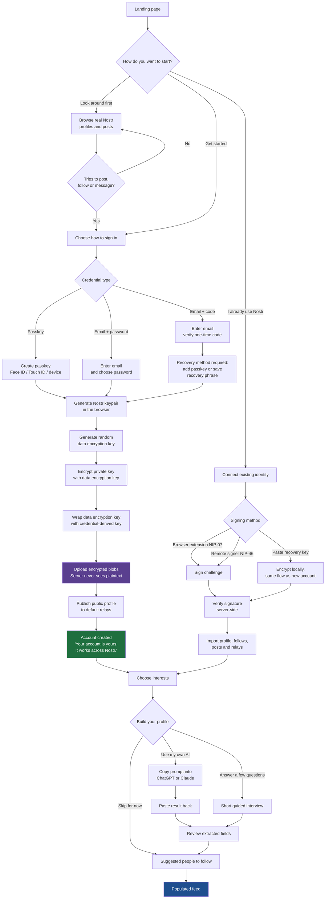

# User Onboarding

Companion document to `Product Requirements Document - Nostr Client MVP.md`, section 6.

Scope: web app, first release.

## 1. Goal

A person who has never heard of Nostr should get from the landing page to a populated feed in under two minutes, leave with a real Nostr identity they fully own, and never be asked to understand a key, a relay, or an event.

A person who already has a Nostr identity should be able to bring it in without the product trying to create a second one.

## 2. Principles

- **Nothing is explained before it is needed.** Onboarding teaches nothing about Nostr. The network is the reward, not the curriculum.
- **The key is created in the browser and never leaves it unencrypted.** The server stores an encrypted blob it cannot open.
- **Familiar words only.** The interface says "your account" and "recovery", not "nsec", "relay", or "signing".
- **No dead ends.** Every step is skippable except securing the account.
- **The feed is never empty.** The first screen after onboarding shows real people and real conversations pulled from the existing network.
- **Honest ownership.** We only claim the user owns their identity because it is technically true, not as marketing.

## 3. Vocabulary

What the system does, and what the interface calls it.

| System concept | Interface wording |
| --- | --- |
| Nostr keypair | Your account |
| Public key / npub | Your public address |
| Private key / nsec | Your recovery key |
| Encrypted key backup | Secure backup |
| Passkey unlock | Sign in with this device |
| Relays | Handled silently; visible only in advanced settings |
| Nostr | Mentioned once, as a benefit, never as a requirement |

The word "Nostr" appears exactly once during onboarding, on the confirmation screen, phrased as a benefit rather than a concept to learn.

## 4. Three entry points

```text
                       Landing page
                            │
        ┌───────────────────┼───────────────────┐
        ▼                   ▼                   ▼
   Get started        I already use        Look around
   (new account)         Nostr              first
```

- **Get started** — the default path. Creates a new identity.
- **I already use Nostr** — deliberately understated. Invisible to people who do not recognise the word.
- **Look around first** — browse real profiles and posts with no account. Registration is deferred until the user tries to post, follow, or message.

## 5. Master flowchart



## 6. Screen by screen

### Screen 1 — Landing

One sentence, one button. No feature list, no Nostr explanation.

> **Let's connect people again.**
> Find the right people, not more content.
>
> `[ Get started ]`
> Already use Nostr? · Look around first

### Screen 2 — Choose how to sign in

Three options, passkey presented first and pre-selected where the browser supports it.

- **This device** — Face ID, Touch ID, or Windows Hello. One tap, nothing to remember.
- **Email and password** — familiar, works everywhere.
- **Email and a code** — no password to remember.

Each option carries one line of plain reassurance, not a security lecture.

### Screen 3 — Creating your account

A two-second progress state while the browser generates and encrypts the keypair. Copy stays human:

> Setting up your account…

No key material, no hex, no `npub` is shown here.

### Screen 4 — Account created

The only place the word Nostr appears, framed as a benefit:

> **Your account is ready.**
> It belongs to you, not to us. It also works on other Nostr apps, so you can leave any time and keep your profile and your people.
>
> `[ Continue ]`

### Screen 5 — Interests

A grid of topics. The user picks three or more. This drives the starter follow list and the first Discover feed.

Minimum three, no maximum, skippable with a visible cost ("we'll suggest less relevant people").

### Screen 6 — Build your profile

Three doors, matching PRD section 10:

- **Use the AI I already use** — copy a generated prompt into ChatGPT or Claude, paste the structured result back.
- **Answer a few questions** — short guided interview.
- **Skip for now** — profile can be built at any time.

Every extracted field is shown for review before saving. Nothing is published without approval.

### Screen 7 — People to follow

Fifteen to twenty real, active accounts from the existing Nostr network, matched to the chosen interests, each with a one-line reason. All pre-selected, individually removable, follow-all in one tap.

### Screen 8 — The feed

Already full, because it draws on the existing network rather than waiting for the platform to grow.

## 7. How the key is created and stored

### Design

Envelope encryption. The Nostr private key is encrypted once with a random data encryption key. That data encryption key is then wrapped separately by each unlock method the user has enabled.

This means a user can add a second unlock method, or rotate a password, without ever re-encrypting or exposing the private key itself.

```text
Nostr private key (32 bytes, secp256k1)
        │
        │  encrypted with AES-256-GCM
        ▼
Encrypted private key blob ──────────────► stored on server
        ▲
        │  uses
        │
Data encryption key (random 32 bytes)
        │
        ├── wrapped by passkey-derived key      ──► stored on server
        ├── wrapped by password-derived key     ──► stored on server
        └── wrapped by recovery-phrase key      ──► stored on server

Server holds only wrapped material.
Plaintext key and data encryption key exist solely in browser memory.
```

### Registration sequence

```text
Browser                                          Server
   │                                                │
   │ 1. Generate secp256k1 keypair                  │
   │    (Web Crypto, never transmitted)             │
   │                                                │
   │ 2. Generate random data encryption key         │
   │                                                │
   │ 3. Encrypt private key with that key           │
   │    AES-256-GCM                                 │
   │                                                │
   │ 4. Derive a wrapping key from the credential   │
   │    passkey  → WebAuthn PRF + HKDF              │
   │    password → Argon2id                         │
   │    phrase   → BIP-39 style seed + HKDF         │
   │                                                │
   │ 5. Wrap the data encryption key                │
   │                                                │
   │ 6. POST encrypted blobs + public key ─────────►│
   │                                                │ 7. Store blobs
   │                                                │    Create account
   │                                                │    Never able to decrypt
   │ ◄──────────────────────── 8. Session token ────│
   │                                                │
   │ 9. Sign profile event locally                  │
   │    and publish to default relays               │
```

### Per-credential wrapping

**Passkey.** The wrapping key is derived from the WebAuthn PRF extension output through HKDF. The secret never exists outside the authenticator and browser memory. If the browser or authenticator does not support PRF, the user is asked to add a password or save a recovery phrase before the account is created.

**Email and password.** The password is stretched with Argon2id using a per-user salt. Two independent values are derived: an authentication verifier sent to the server, and a wrapping key that never is. The server can verify the password without being able to unwrap anything.

**Email and one-time code.** A one-time code proves control of a mailbox but supplies no user-held secret, so it cannot on its own protect a key without the server holding it. This path therefore requires a second factor before the account is created: either a passkey or a saved recovery phrase. This constraint is enforced, not suggested.

### Sign-in sequence

```text
Browser                                          Server
   │                                                │
   │ 1. Authenticate ──────────────────────────────►│
   │ ◄──────────── 2. Encrypted blobs + session ────│
   │                                                │
   │ 3. Re-derive wrapping key from credential      │
   │ 4. Unwrap data encryption key                  │
   │ 5. Decrypt private key into memory only        │
   │                                                │
   │ 6. Sign events locally for this session        │
```

The decrypted key is held in non-persistent memory for the session, never written to `localStorage`, and cleared on sign-out, tab close, and inactivity timeout.

## 8. Existing Nostr users

Three ways in, listed in order of safety.

1. **Browser extension (NIP-07)** — preferred. The key never enters our application.
2. **Remote signer (NIP-46)** — the key stays in the user's own signer.
3. **Paste a recovery key** — accepted but discouraged, with a plain warning. The key is encrypted in the browser using the same envelope flow as a new account.

In all three cases ownership is proven by signing a server-issued challenge. **Entering an `npub` alone never grants access to an identity.**

Once verified, the product imports the user's profile metadata, follow list, recent posts, and relay preferences, then sends them to the interests step with everything pre-filled. Their feed is populated before they finish onboarding.

If the identity already exists in our index as an unclaimed public profile, that profile is merged into the new account rather than duplicated.

## 9. Revealing the recovery key

The private key is never shown during onboarding. It is always available afterwards.

**Where:** Settings → Your account → Show recovery key. Re-authentication is required every time.

**When we nudge:** once the user is invested rather than at signup — after their first post, or on day three of activity, whichever comes first. Shown as a single dismissable banner, never a blocking modal, and never repeated more than twice.

> **Make sure you can't lose this account.**
> Save your recovery key and you can get back in from any device, even if you lose this one.

**What we offer:**

- Copy the key
- Download an encrypted key file (NIP-49 format)
- Reveal a recovery phrase
- Connect a browser extension or remote signer and move to full self-custody

## 10. Recovery

```text
Lost access
     │
     ├── Has another registered device or passkey ──► Sign in, done
     │
     ├── Remembers password ───────────────────────► Sign in, done
     │
     ├── Saved recovery key or phrase ─────────────► Restore and re-wrap
     │                                                 under a new credential
     │
     └── None of the above ────────────────────────► Account cannot be recovered
```

That last branch is the honest cost of real ownership and must be stated plainly at the moment a user declines to add a recovery method — not buried in terms.

> We can't reset this for you. That's the trade for an account nobody can take away from you.

Adding a recovery method later is always possible and takes one step.

## 11. Edge cases

| Situation | Behaviour |
| --- | --- |
| Browser lacks WebAuthn PRF | Fall back to password or recovery phrase before account creation |
| User abandons midway after key creation | Account exists; resume from the last completed step on return |
| Same email used twice | Treat as sign-in, never silently create a second identity |
| Pasted key is malformed | Validate and reject before any account is created |
| Relays unreachable at signup | Create the account anyway, queue the profile publish, retry in background |
| Private browsing or blocked storage | Warn before creation that the session cannot persist |
| User declines every recovery method | Allowed, after an explicit confirmation of the consequence |
| Claiming an already-indexed profile | Require a signed challenge, then merge into the existing indexed profile |

## 12. What the system never does

- Transmit, log, or store an unencrypted private key.
- Store a decrypted key in `localStorage`, `sessionStorage`, cookies, or any analytics payload.
- Include key material in error reports or crash traces.
- Publish anything to Nostr during onboarding beyond the user's own public profile.
- Follow accounts on the user's behalf without their confirmation.
- Grant an identity on the basis of an entered `npub`.
- Claim the user owns their key at any point where that is not technically true.

## 13. Measuring it

| Metric | Target |
| --- | --- |
| Landing to populated feed | Under 2 minutes, median |
| Registration completion | Above 70% |
| Passkey chosen over password | Above 50% |
| Interests step completed | Above 85% |
| Profile started, by either route | Above 60% |
| Follows at least five people | Above 80% |
| Recovery method in place by day 7 | Above 60% |
| Existing-Nostr sign-in success | Above 95% |
| Support requests about keys or relays | Near zero |

The last row is the real test. If people are asking us what a relay is, the onboarding has failed regardless of how the other numbers look.

## 14. Writing the copy

- Say "your account", not "your keypair".
- Say "recovery key", not "nsec" or "private key", outside advanced settings.
- Never write "decentralized", "protocol", "cryptographic", or "relay" in the default flow.
- State consequences in plain language: "you won't be able to get back in", not "account recovery is not available".
- One idea per screen.
- Every security claim must be literally true. If the server could theoretically decrypt something, do not say that it cannot.
